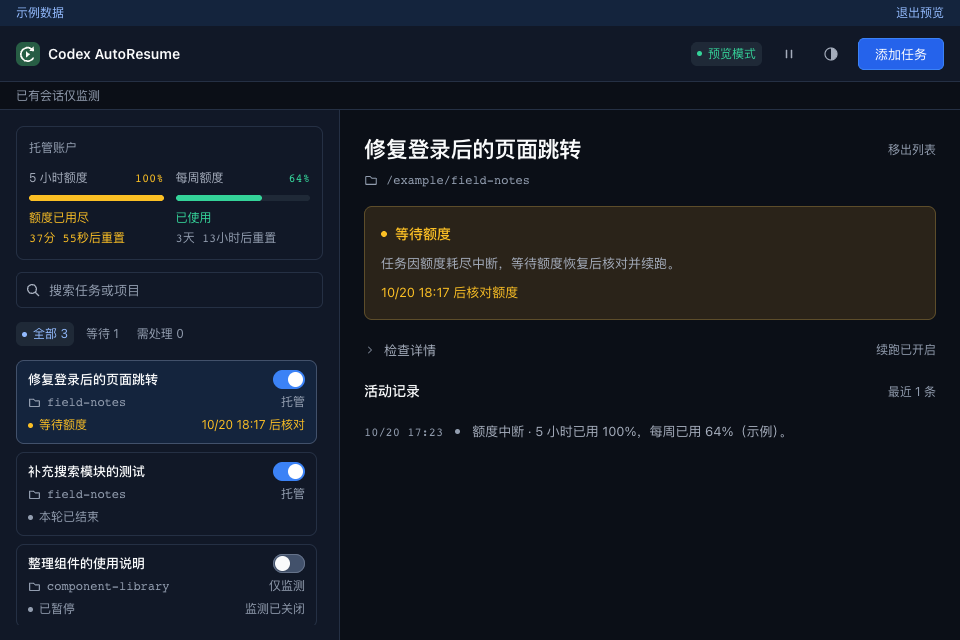

# Codex AutoResume

一个轻量的 macOS 菜单栏 / Windows 托盘工具：任务因 Codex 额度耗尽而中断时，等待额度恢复，再继续执行。

**当前为 Alpha。Mac 原聊天续跑是实验功能：已验证正常图标启动、原聊天连接和续跑开关，真实额度耗尽后的自动恢复仍待实测。**



## 下载

本页对应 [v0.2.0-alpha.1](https://github.com/Wu-Zzz/Codex-AutoResume/releases/tag/v0.2.0-alpha.1)。安装包由 GitHub Actions 云端构建。

| 系统 | 下载 | 原 Desktop 聊天续跑 |
| --- | --- | --- |
| Mac · M 系列 | [ARM64 DMG](https://github.com/Wu-Zzz/Codex-AutoResume/releases/download/v0.2.0-alpha.1/Codex-AutoResume-v0.2.0-alpha.1-macos-arm64.dmg) | 包含实验组件，已验证本机连接 |
| Mac · Intel | [x64 DMG](https://github.com/Wu-Zzz/Codex-AutoResume/releases/download/v0.2.0-alpha.1/Codex-AutoResume-v0.2.0-alpha.1-macos-x64.dmg) | 包含实验组件，未做 Intel 实机验证 |
| Windows · x64 | [EXE 安装包](https://github.com/Wu-Zzz/Codex-AutoResume/releases/download/v0.2.0-alpha.1/Codex-AutoResume-v0.2.0-alpha.1-windows-x64.exe) | 暂不支持；可用新建终端任务 |

Mac 打开 DMG 后拖入 Applications；Windows 运行 EXE 安装。[SHA-256 校验文件](https://github.com/Wu-Zzz/Codex-AutoResume/releases/download/v0.2.0-alpha.1/SHA256SUMS.txt)随版本提供。Mac 仅有 ad-hoc 签名，未做 Apple 开发者签名与公证；Windows 未做代码签名。

## 在 Mac 原聊天中使用

需要 **Codex Desktop 构建 `20770`、默认 zsh 环境**，Codex 安装在 `/Applications`。其他构建会拒绝启用。此功能使用随包提供的修改版执行程序，不修改官方应用、账号凭据或聊天记录；**启用期间暂不支持 Codex 语音**。

1. 打开 AutoResume，点击顶部连接状态，选择 **自动连接 Codex → 开启自动连接**。
2. 用 **⌘Q** 完全退出 Codex，再从平时的图标打开。以后正常打开即可，无需专用启动器。
3. 先在 Codex 原聊天中开始任务，再到 AutoResume 任务列表中，为该聊天打开 **自动续跑**。
4. 保持 AutoResume、Codex 和电脑运行。关闭 AutoResume 窗口仍会驻留托盘；**没有防休眠功能**。

每个聊天需单独开启。重启、断开连接、用户新输入或配置变化会关闭续跑授权，需要重新开启；不会补跑重启前的历史中断。要恢复官方执行程序，关闭“自动连接 Codex”并重开 Codex。

## 新建终端任务（Mac / Windows）

1. 安装官方 [Codex CLI](https://github.com/openai/codex#quickstart)，已核查版本为 `0.145.0`。
2. 点击 **添加任务 → 新建终端任务**，选择项目，勾选 **额度恢复后自动续跑**，打开 Codex 终端。
3. 在终端中完成官方 ChatGPT 登录并输入任务。此环境独立，首次需另行登录，不复制已有凭据，暂不支持 API Key 模式。
4. 保持终端、AutoResume 和电脑运行；应用重启或终端断开后，不自动恢复旧任务。

其他已有 Desktop / CLI 会话可通过 **添加任务 → 历史监测** 查看状态。监测开关不授权自动执行。

## 续跑规则与限制

- 只处理明确的额度耗尽终态 `usageLimitExceeded`。正常结束、用户停止、等待审批或需要回复时，不自动催促。
- 使用真实额度及重置时间；未知就显示未知，不固定等待五小时，到点后仍会核对额度。
- 权限、会话状态或提交结果不明时停止，不放宽权限、不盲目重发。
- 暂停全部、关闭开关或退出 AutoResume，只停止后续自动提交，不停止正在执行的任务。
- 移出列表不删除原聊天或项目文件。
- 尚未提供防休眠、Git 分支检查、系统通知 / Webhook、CLI 自动安装或开机启动。

## 验证状态

本地通过 190 项 Rust 单元测试、6 项模拟连接测试、15 项前端测试及静态检查。Mac Apple Silicon 已验证一次普通终端任务执行，以及正常图标连接原 Desktop 聊天、续跑开关可用。

发布流程检查两个 Mac 安装包及 Windows 安装包。**真实额度恢复、Intel Mac / Windows 实机交互尚未验收**；模拟测试和云端构建不能代替这些验证。详见[验证记录](docs/VALIDATION.md)和[实验连接说明](docs/desktop-bridge.md)。

## 开发

Tauri 2 + Vue 3 + TypeScript + Rust + SQLite。需要 Node.js 22.12+、Rust stable 和 [Tauri 系统依赖](https://v2.tauri.app/start/prerequisites/)。

```sh
npm ci
npm run tauri dev
```

常规打包：`npm run tauri build`。原聊天组件构建见[开发说明](docs/desktop-bridge.md)。仅预览示例界面：`npm run dev`，在地址后加 `?demo=1`。

[开发约束](AGENTS.md) · [实施方案](PLAN.md) · [MIT License](LICENSE)。随包修改版 Codex 的许可证与来源见[上游说明](integrations/codex/README.md)。本项目与 OpenAI 无隶属关系。
